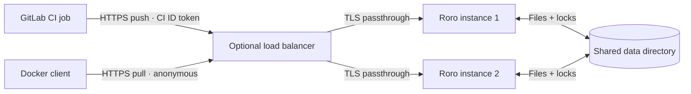

# roro

**A container registry with less to operate.**

Roro (Roll On Roll Off) is a small OCI/Docker registry built for GitLab CI.
Your GitLab project path becomes the image namespace; your GitLab role determines
write access. Push with the identity your CI job already has, and pull with ordinary
Docker clients. Run the registry as one statically linked Rust binary backed by
a directory on disk—no database, object store, or separate auth service to deploy.

- **GitLab projects are your namespaces.** `team/app` automatically gets
  `registry.example.com/team/app` and its subpaths. No repository provisioning.
- **GitLab roles control writes.** Roro verifies signed CI job claims: Developers
  can publish; Maintainers can delete. No second user database or ACL to maintain,
  no stored GitLab API credentials or OAuth app setup. Pulls remain public.
- **Disk is the storage backend.** Content-addressed images, resumable uploads,
  and filesystem locks instead of a database or distributed lock service.
- **One instance or several sharing storage.** Replicas use the same directory;
  no sticky sessions. Shared storage must provide working cross-host locks—see
  [deployment requirements](#shared-disk-deployment).
- **HTTPS is not optional.** Supply a certificate or let Roro generate a
  persistent self-signed one. There is no plaintext fallback.
- **Cleanup is built in.** Automatic retention and garbage collection reclaim
  old content without a separate cleanup service.

Roro fits teams that want a straightforward registry for **publicly pullable
CI images**, not another platform to administer. It is not a private image vault
or an upstream registry cache.

**Know the defaults:** anyone who can reach the registry can pull images.
`latest` is kept indefinitely; every other tag expires 30 days after its last
push, including release tags. Pulls do not extend retention. Read the
[retention rules](#retention--read-before-storing-production-images) before storing
production images.

## One binary. One data directory. Optional replicas.

Start with one Roro instance and a disk. **Multiple instances can read and write
the same shared data directory**, coordinating through filesystem locks rather
than a database or lock service. Put them behind a load balancer; uploads do not
need sticky sessions.



For a single instance, clients connect directly—no load balancer required.
GitLab supplies the CI identity and signing keys; Roro handles the registry token
exchange itself. Each Roro listener is TLS-only.

This is **shared storage, not storage replication**: replicas still depend on the
same filesystem. Across hosts, use storage with working cross-client advisory
locks and validate it with the [acceptance checklist](docs/acceptance.md).
Local tests do not certify your NFS setup. See
[shared-disk deployment](#shared-disk-deployment) for configuration and mount requirements.

## Run

Download and unpack the static Linux release for your architecture. No Nix,
container, OpenSSL or glibc is needed on the host. Save this as `config.yaml`:

```yaml
listen: 0.0.0.0:443
dataRoot: /var/lib/roro
publicUrl: https://registry.example.com
gitlabIssuer: https://gitlab.example.com
# Optional: supply both PEM files; omit both to generate a self-signed certificate.
# tlsCert: /etc/roro/fullchain.pem
# tlsKey: /etc/roro/private-key.pem
```

```sh
roro serve --config config.yaml
```

HTTPS is mandatory. With generated TLS, install `dataRoot/gc/tls-cert.pem` in
your Docker clients' trust stores. See [operations](docs/operations.md) for
installation, port permissions and certificate management.

## GitLab namespaces and CI publishing

**Create the project in GitLab, not in Roro.** A GitLab project `team/app`
automatically has write access to `registry.example.com/team/app` and its
subpaths. Groups and subgroups follow the GitLab project path. There are no
registry namespaces to provision or separate permissions to synchronize:
Roro derives the namespace and write permissions from the signed CI job identity.

```yaml
publish:
  image: docker:cli
  services:
    - docker:dind
  id_tokens:
    REGISTRY_TOKEN:
      aud: https://registry.example.com
  script:
    - echo "$REGISTRY_TOKEN" | docker login registry.example.com -u gitlab-ci-token --password-stdin
    - docker build -t "registry.example.com/$CI_PROJECT_PATH:$CI_COMMIT_SHA" .
    - docker push "registry.example.com/$CI_PROJECT_PATH:$CI_COMMIT_SHA"
```

Runner/Docker service configuration remains your existing CI setup. This is not
a runner registration token, `CI_JOB_TOKEN`, access token, or user password: the
password is an audience-bound **CI OIDC ID token**. The username is ignored.
Do not print the token or enable shell tracing around credentials.

Project `team/app` may publish `team/app:tag` and `team/app/worker:tag`, but not
`team/application` or another project's path. The registry checks GitLab-signed
`job_project_id`, `job_project_path`, source-project identity, and user access level.
Developer (30) or higher may publish. Maintainer (40) or higher may delete.
Merge-request/external-pull-request pipelines are denied, even when the triggering
user has higher privileges. Protected refs are **not** required in v1.

All GET/HEAD image reads and tag lists are anonymous. The `/v2/` discovery endpoint
uses the standard Bearer challenge; anonymous clients receive pull-only tokens.
Registry tokens last at most five minutes and never outlive their CI ID token.
An ID token can remain usable after its job finishes, until its signed expiry.
GitLab API credentials and OAuth applications are not required. Supported GitLab
versions must provide the job-project claims (18.4+). See [GitLab CI identity documentation](https://docs.gitlab.com/ci/secrets/id_token_authentication/).

## Retention — read before storing production images

An elected instance runs cleanup at startup and hourly:

- Keep the tag `latest` indefinitely.
- Expire every other tag **30 days after its last successful manifest PUT**.
- Keep unreachable content for at least seven continuously observed days.
- Remove upload sessions idle for 24 hours, skipping active locks.

This also expires version/release tags. No tag except `latest` is exempt. Reading
an image does not refresh retention. Re-pushing a tag does. Deleting by tag removes
that tag; deleting by digest removes its manifest and associated tags. A manifest
referenced by another stored manifest cannot be explicitly deleted until that
reference is removed. GC traverses retained image indexes and child manifests.

Cleanup never requires stopping serving instances. It pauses metadata commits and
new content opens behind a filesystem gate while marking/sweeping; already open
downloads continue. Large registries can see lock waits or retryable 503 responses.
This favors simple correctness over zero-pause collection. Untagged manifests act
as temporary roots during their grace period. Corrupt/incomplete graphs abort
sweeping rather than guessing what to delete.

## Shared-disk deployment

Multiple Roro instances can read and write the **same shared data directory**.
Use the same `dataRoot`, `publicUrl`, GitLab issuer, service UID and storage format
on every instance. No sticky sessions or separate coordination service is needed.

Shared storage must provide cross-client advisory locks and durable writes.
Use a local Linux filesystem or a properly configured NFSv4 hard mount; validate
cross-host behavior using the [acceptance checklist](docs/acceptance.md). Local
tests do not certify an NFS setup. Never delete lock files or steal locks by age.

See [operations](docs/operations.md#shared-disk-deployment) for mount restrictions,
backup and migration procedures. Back up the **entire data directory**, including
its signing secrets and namespace bindings—not just the images.

## Compatibility

Implements Distribution `/v2/` image pull/push, SHA-256 blobs, resumable uploads,
blob mounts, ranges, tag pagination, OCI/Docker manifests and indexes, and manifest
deletion. Incoming request bodies are streamed to staging files (100 GiB maximum
per upload request, 60-second idle timeout); manifest bodies are limited to 10 MiB.
Staging and immutable publication temporarily require additional disk space.
Only canonical lowercase SHA-256 digests are accepted. Schema-1 images, catalog
listing, private pulls, artifact-referrer discovery, replication, quotas, scanning,
and GitLab's deprecated external-registry integration are not implemented.
No full OCI certification or Docker/BuildKit acceptance claim is made without the
external checks in [docs/acceptance.md](docs/acceptance.md).

## License and security

Roro is MIT-licensed; dependencies retain their own licenses. See [LICENSE](LICENSE),
[SECURITY.md](SECURITY.md), and the [contribution guide](CONTRIBUTING.md).
All pulls are public and retention is enabled automatically—read the retention
section before storing images. Proxy caching and rebuild retention are not implemented.
